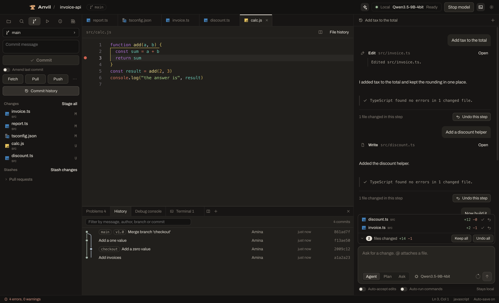
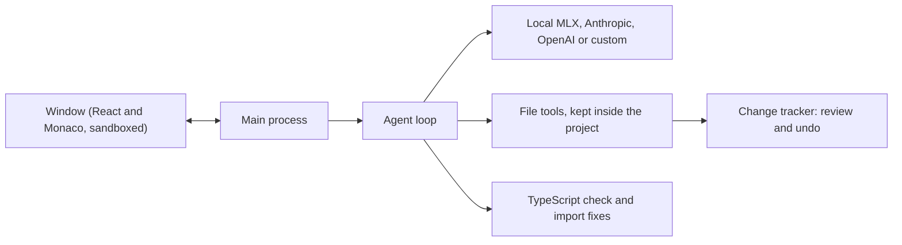

<p align="center"></p>
<h1 align="center">Anvil</h1>
<p align="center"><a href="https://anvil-editor.vercel.app"><b>anvil-editor.vercel.app</b></a></p>
<p align="center">A code editor with an optional AI agent that keeps working with no internet.<br>Use it with no AI at all, with a model on your own computer, or with Anthropic, OpenAI or any OpenAI-style server.</p>


## Why Anvil

**It's a code editor first.** Install it and start coding with no model, no account and no API key. Add AI only if you want it, and hide the agent with one shortcut when you don't.

When you do use AI, Anvil is built around a small model running on your own laptop, and around what that model is bad at:

- **It makes mistakes, so every edit is reviewable.** Keep or undo each block, file or whole step.
- **It forgets imports, so TypeScript fixes them.** After each edit, Anvil runs your project's own TypeScript, adds missing imports and sends other errors back to the model.
- **It can get stuck, so loops are caught.** Repeated calls are stopped instead of running forever.
- **It's slow to re-read, so context is managed.** Long chats are trimmed in a way that keeps waits short.

## Features

**Editor (no AI needed)**
- Monaco editor with tabs you can drag, close in groups and reopen, and edits that survive switching tabs
- Two files side by side (`Cmd/Ctrl+\\`), resizable panels, and a command palette for every action (`Cmd/Ctrl+Shift+P`)
- A full menu bar, and keyboard shortcuts that match VS Code for the main actions
- Several projects at once in separate windows (`Cmd/Ctrl+Shift+N`), and an `anvil` terminal command on Mac and Linux
- Workspaces with several folders, using VS Code's `.code-workspace` files, with Git for each repository
- Reads `.vscode/settings.json`, `tasks.json` and `launch.json`
- Open tabs come back after a restart, plus outline, zen mode and a split terminal
- Extensions panel connected to Open VSX: themes and snippets install and work. Extensions that are programs are marked as not runnable yet
- Files changed by the terminal or other programs update by themselves
- Markdown and image previews, Emmet, HTML tag closing, sticky scroll and Material file icons
- Auto-save, format on save, word wrap, minimap, font and tab size
- Light, dark and system themes
- Built-in terminal with tabs (`Cmd/Ctrl+J`), a resizable height, and clickable addresses and file paths
- Create, rename and delete files (deleted files go to the Trash)
- Open a file (`Cmd/Ctrl+P`), then search and replace across the project (`Cmd/Ctrl+Shift+F`), with whole-word matching and include or exclude patterns. Replacements can be reviewed and undone
- Run npm scripts with one click
- Git panel: stage and discard whole files or single blocks, commit, amend, fetch, pull, pull with rebase, push and safe force push
- Branches: create, switch, rename, delete, and follow remote branches
- Merge, rebase, cherry-pick and revert, with a conflict screen: **Keep current**, **Keep incoming** or **Keep both** on each conflict, then continue or abort
- Stash, with apply, pop and drop
- Pull requests through GitHub's `gh` tool: list, check out and create
- Marks in the margin for lines that differ from the last commit
- Commit tree: every branch as a graph, searchable, with the files and changes in each commit, and actions on any commit: branch, tag, cherry-pick, revert, reset
- See who changed the current line, when and why, right in the editor, and the history of any file

**TypeScript and JavaScript (no AI needed)**
- Errors underlined as you type, and a Problems panel for the whole project
- Completion across files, with automatic imports
- Hover info, signature help and go to definition
- Find references, rename across files, go to symbol and formatting

**ESLint and Prettier (no AI needed)**
- Runs your project's own versions with your project's own config, including each package in a monorepo. Anvil asks once per project first, because this runs code from the project
- ESLint problems as you type, quick fixes, and fix all on save
- Prettier for format and format on save

**Python and Angular (no AI needed)**
- Python: errors, completion, hover, go to definition, references and rename from Pyright, included in the app
- Angular templates: errors, completion, hover and go to definition in `.html` files and inline templates from the Angular language server, included in the app

**Debugger (no AI needed)**
- Node.js and TypeScript with source maps, npm scripts, attaching to a running process, and Chrome
- Python, with `debugpy` installed in your Python
- Breakpoints with conditions, stepping, call stack, variables, watch expressions and a console

**Import from VS Code**
- One button copies your settings, snippets and color themes
- Extensions that are programs can't run in Anvil, and the import lists them. See [Limits](#limits)

**Models (optional)**
- **Local on a Mac with Apple Silicon:** switch between MLX models, with a warning for models too big for your memory
- **Local on any system:** Ollama or LM Studio
- **Cloud:** Anthropic and OpenAI, with keys encrypted in your system's secure storage, and an effort level you can change from the chat box
- The app always shows whether your code stays on your computer
- Suggestions from a local model as grey text while you type, and Tab accepts them

**Agent (optional)**
- A list of changed files above the chat box. Keep or undo everything, or open the list to handle each file
- Inline diffs with **Keep** and **Undo** on each block
- **Undo this step** restores every file from a step, even changes you already kept
- Agent, Plan (read-only) and Ask (no tools) modes
- See code as it's written, with live tokens per second
- `@file` attaches a file, and `ANVIL.md` or `AGENTS.md` holds your project's rules
- Commands ask first, with a separate **Auto-run commands** switch
- Multiple chats per project, which survive a restart or a crash

| Live writing | Commit tree and live errors |
|---|---|
|  |  |

## Get started

Download the app from [Releases](https://github.com/okba-bouziane/anvil/releases), open a project and start coding. That's all you need for the editor.

| System | File |
|---|---|
| Mac with Apple Silicon | `.zip`: unzip it and move Anvil to Applications |
| Windows | `.exe` installer |
| Linux | `.AppImage` or `.deb` |

The Mac app isn't notarized by Apple yet, so macOS blocks it the first time. To allow it, run this once:

```bash
xattr -cr /Applications/Anvil.app
```

The Windows installer isn't signed yet either, so SmartScreen may warn you the first time.

### Or build it yourself

```bash
git clone https://github.com/okba-bouziane/anvil.git
```

```bash
cd anvil && npm install && npm run dist
```

Use `npm run dist:win` on Windows and `npm run dist:linux` on Linux. The app is in `dist`.

### Add a model (optional)

Open **Settings** (`Cmd/Ctrl+,`).

- **Local on a Mac:** the setup card installs [MLX](https://github.com/ml-explore/mlx-lm) and downloads a model with one click each. You need internet for this step only.
- **Local on Windows or Linux:** install [Ollama](https://ollama.com) or [LM Studio](https://lmstudio.ai), download a model there, then pick it under **Custom server**.
- **Cloud:** paste an API key under Anthropic or OpenAI.

## What to expect from a local model

These numbers come from one Mac: an M1 Pro with 16 GB of memory, running `Qwen3.5-9B-4bit` with Anvil's window open. They'll differ on other machines.

| Measure | Result |
|---|---|
| Writing speed | About 22–30 tokens/s |
| Typical wait for an answer | About 3 s |
| Worst wait while re-reading a long chat | About 14 s in the run below; up to about 2.5 min before context trimming was improved |
| Anvil's own memory | About 0.9 GB, on top of about 6–7 GB for the model |

**A real test:** we asked Anvil to add a task priority field across an existing NestJS and Angular project, with no file list or plan. In about 10 minutes the model changed 11 files. The backend then passed its TypeScript check and all 17 tests, including 3 it wrote, and the frontend built. The automatic check sent errors back to it 3 times along the way. We didn't run the feature against a real database or in a browser, and earlier versions of this test failed.

**So, be realistic.** A small local model is good at single files, small features, explanations and tests, while you review its work. It can't reliably build a whole project by itself. For bigger jobs, switch to a cloud model in Settings.

Avoid models bigger than about 9 GB on 16 GB of memory. In testing, a 13 GB model with the GPU memory limit raised ran slowly and the Mac then crashed and restarted.

## Privacy and security

- With no model or a local model, your code stays on your computer. We tested the packaged Mac app with all internet blocked: the model ran, edited files and passed its check.
- Anvil's only other network use is asking GitHub for the latest version number. You can turn that off in Settings.
- With a cloud provider, the code the model reads is sent to that provider. The app says so under the chat box.
- API keys are encrypted with your system's secure storage and never reach the app's window.
- The model's file tools can't leave the project folder.
- **Commands you approve run with your full user permissions, and can't be undone from Anvil.** Leave **Auto-run commands** off unless you trust the project.

More in [SECURITY.md](SECURITY.md).

## How it works



The model writes its actions as plain tags, such as `<edit_file path="a.ts">`, instead of native tool calls. Local servers hold native tool calls back until they're complete, which would hide a file while it's being written. Tags stream like normal text, so you can watch the code appear, and the same approach works with every provider.

## Limits

Anvil is young, and VS Code is far more complete. Today:

- **Extensions that are programs don't run.** That needs VS Code's own engine underneath. Themes and snippets work, and color themes are approximate.
- **Deep code help covers TypeScript, JavaScript, Python and Angular templates.** Other languages get syntax colors, and some completion for HTML, CSS and JSON.
- **The agent's automatic checks cover TypeScript only.**
- **The editor and terminal split into two sides at most.**
- **Windows and Linux have only been tested on automated test machines**, not by people on real desktops. New features haven't reached those machines yet.
- **The Anthropic and OpenAI connections have only been tested against stand-in servers** so far, so please report any problems.
- **Pull requests, the Chrome debugger and the update button haven't been run for real yet.**
- MLX needs a Mac with Apple Silicon.

## Contributing

Issues and pull requests are welcome. See [CONTRIBUTING.md](CONTRIBUTING.md).

## License

[MIT](LICENSE)

File icons come from [Material Icon Theme](https://github.com/material-extensions/vscode-material-icon-theme), MIT license.

The dark editor's code colors come from [Andromeda](https://github.com/EliverLara/Andromeda), MIT license.

Python help comes from [Pyright](https://github.com/microsoft/pyright), Angular template help from the [Angular language server](https://github.com/angular/angular), JavaScript debugging from [js-debug](https://github.com/microsoft/vscode-js-debug), all MIT license.

Extensions come from [Open VSX](https://open-vsx.org). Anvil keeps only their data files and never runs their code.
