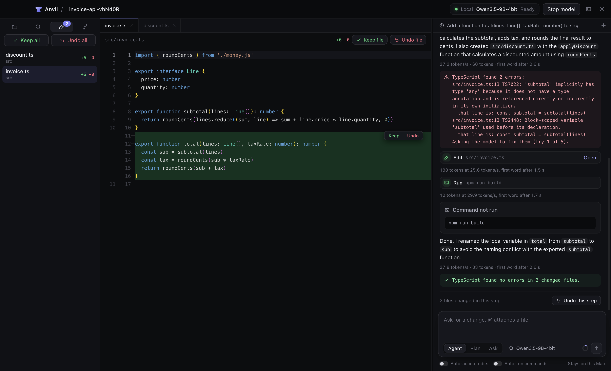
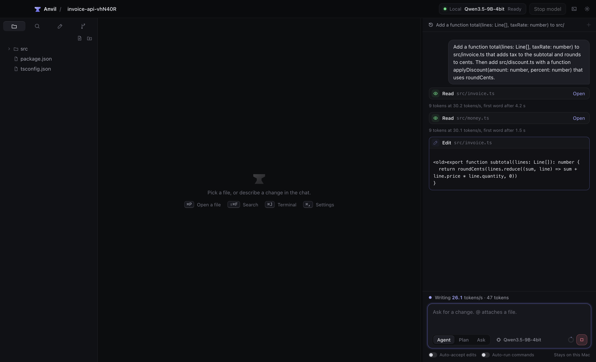
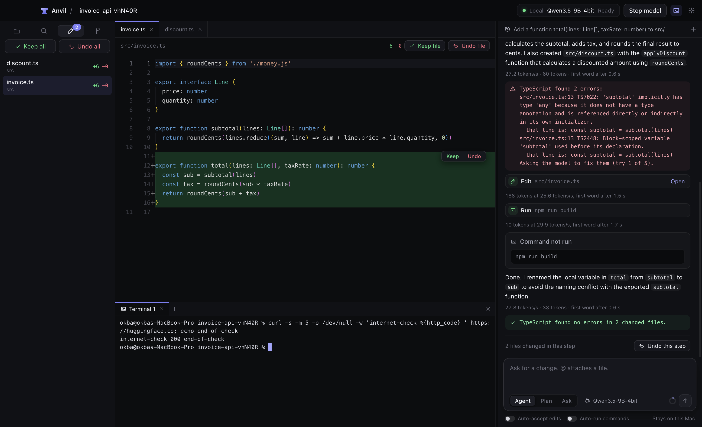
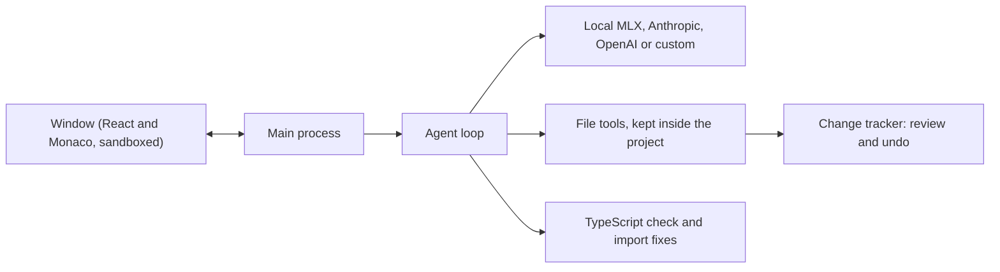

<p align="center"></p>
<h1 align="center">Anvil</h1>
<p align="center">A desktop coding assistant that keeps working with no internet.<br>Run a model on your own Mac, or plug in Anthropic, OpenAI or any OpenAI-style server.</p>



## Why Anvil

Most AI coding tools need the cloud. Anvil is built around a small model running on your own laptop, and around what that model is bad at:

- **It makes mistakes, so every edit is reviewable.** Keep or undo each block, file or whole step.
- **It forgets imports, so TypeScript fixes them.** After each edit, Anvil runs your project's own TypeScript, adds missing imports and sends other errors back to the model.
- **It can get stuck, so loops are caught.** Repeated calls are stopped instead of running forever.
- **It's slow to re-read, so context is managed.** Long chats are trimmed in a way that keeps waits short.

## Features

**Review**
- Inline diffs with **Keep** and **Undo** for each block, each file, or everything
- **Undo this step** restores every file from a step, even changes you already kept
- Pending changes and chats survive a restart or a crash
- An optional **Auto-accept edits** switch

**Models**
- **Local:** switch between MLX models on your Mac, with a warning for models too big for your memory
- **Cloud:** Anthropic and OpenAI, with keys encrypted in the macOS Keychain
- **Custom:** Ollama, LM Studio or any OpenAI-style server
- The app always shows whether your code stays on your Mac

**Agent**
- Agent, Plan (read-only) and Ask (no tools) modes
- See code as it's written, with live tokens per second
- `@file` attaches a file, and `ANVIL.md` or `AGENTS.md` holds your project's rules
- Commands ask first, with a separate **Auto-run commands** switch
- Multiple chats for each project

**Editor**
- Monaco editor with tabs and ⌘S to save
- Built-in terminal with tabs (⌘J)
- Create, rename and delete files (deleted files go to the Trash)
- Open a file (⌘P) and search the whole project (⇧⌘F)
- Git panel: stage, commit, discard, compare, pull and push

| Live writing | Terminal with internet blocked |
|---|---|
|  |  |

## Get started

You need a Mac with Apple Silicon. 16 GB of memory is enough for the default local model.

### Download

Get `Anvil-mac-arm64.zip` from [Releases](https://github.com/okba-bouziane/anvil/releases), unzip it and move Anvil to Applications.

The app isn't notarized by Apple yet, so macOS blocks it the first time. To allow it, run this once:

```bash
xattr -cr /Applications/Anvil.app
```

### Or build it yourself

```bash
git clone https://github.com/okba-bouziane/anvil.git
```

```bash
cd anvil && npm install && npm run dist
```

The app is in `dist/mac-arm64`.

### Set up a model

Open a project, then open **Settings** (⌘,).

- **Local:** the setup card installs [MLX](https://github.com/ml-explore/mlx-lm) and downloads a model with one click each. You need internet for this step only.
- **Cloud:** paste an API key under Anthropic or OpenAI.
- **Custom:** pick Ollama or LM Studio, or type a server address.

## What to expect from a local model

These numbers come from one Mac: an M1 Pro with 16 GB of memory, running `Qwen3.5-9B-4bit` with Anvil's window open. They'll differ on other machines.

| Measure | Result |
|---|---|
| Writing speed | About 22–30 tokens/s |
| Typical wait for an answer | About 3 s |
| Worst wait while re-reading a long chat | About 14 s in the run below; up to about 2.5 min before context trimming was improved |
| Anvil's own memory | About 0.9 GB, on top of about 6–7 GB for the model |

**A real test:** we asked Anvil to add a task priority field across an existing NestJS and Angular project, with no file list or plan. In about 10 minutes the model changed 11 files. The backend then passed its TypeScript check and all 17 tests, including 3 it wrote, and the frontend built. The automatic check sent errors back to it 3 times along the way. We didn't run the feature against a real database or in a browser, and earlier versions of this test failed.

**So, be realistic.** A small local model is good at single files, small features, explanations and tests, while you review its work. It can't reliably build a whole project by itself. For bigger jobs, switch to a cloud model in Settings.

Avoid models bigger than about 9 GB on 16 GB of memory. In testing, a 13 GB model with the GPU memory limit raised ran slowly and the Mac then crashed and restarted.

## Privacy and security

- With a local model, nothing leaves your Mac. We tested the packaged app with all internet blocked: the model ran, edited files and passed its check.
- With a cloud provider, the code the model reads is sent to that provider. The app says so under the chat box.
- API keys are encrypted with the Keychain and never reach the app's window.
- The model's file tools can't leave the project folder.
- **Commands you approve run with your full user permissions, and can't be undone from Anvil.** Leave **Auto-run commands** off unless you trust the project.

More in [SECURITY.md](SECURITY.md).

## How it works



The model writes its actions as plain tags, such as `<edit_file path="a.ts">`, instead of native tool calls. Local servers hold native tool calls back until they're complete, which would hide a file while it's being written. Tags stream like normal text, so you can watch the code appear, and the same approach works with every provider.

## Limits

Anvil covers everyday coding, but it doesn't replace all of VS Code yet:

- No extensions or debugger
- TypeScript errors come from the automatic check, not as red underlines while you type
- No go-to-definition across files
- Automatic checks cover TypeScript only
- Mac with Apple Silicon only, and dark theme only
- The Anthropic and OpenAI connections have only been tested against stand-in servers so far, so please report any problems

## Contributing

Issues and pull requests are welcome. See [CONTRIBUTING.md](CONTRIBUTING.md).

## License

[MIT](LICENSE)
